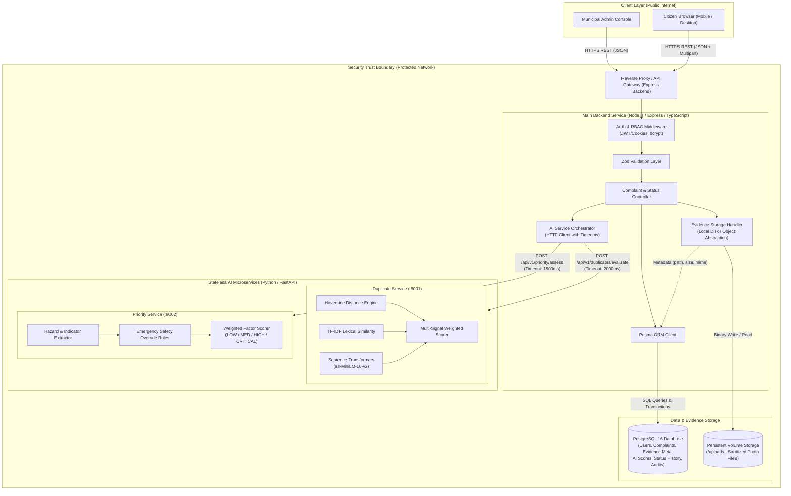
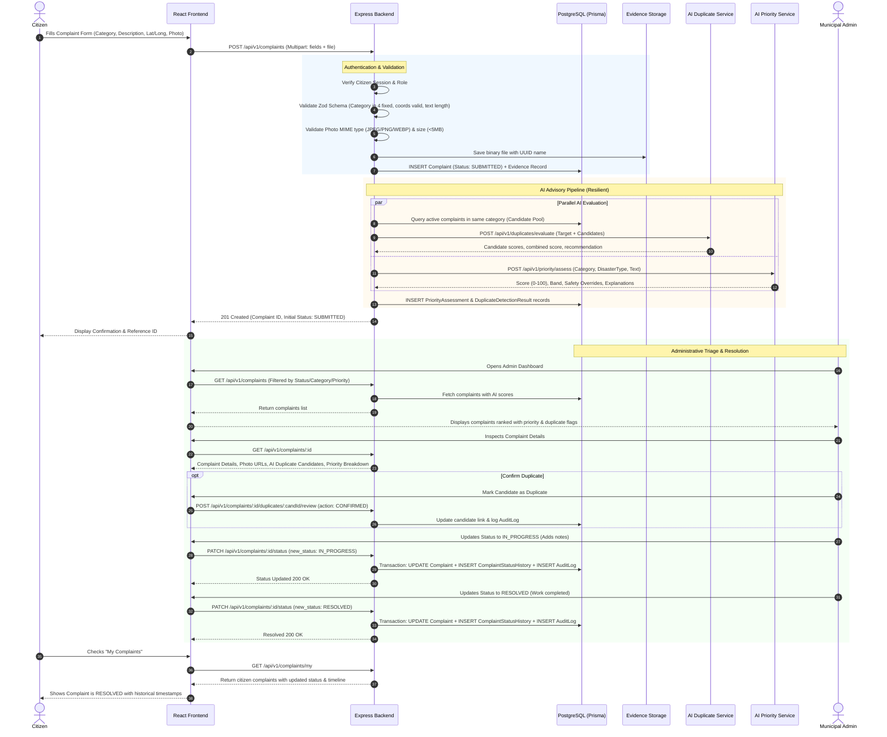

# UrbanPulse — System Architecture & Technical Blueprint
**Sprint 0: Requirements, System Architecture and Project Blueprint**
*Document Version: 1.0.0*

---

## 1. High-Level Architectural Vision

UrbanPulse follows a **modular, local-first service architecture** organized as a unified monorepo. It prioritizes clarity, maintainability, and operational simplicity over distributed complexity.

The system decouples user-facing web interactions and core transactional business logic from computational AI workflows (duplicate detection and severity scoring). 

### Architectural Core Principles
1. **Single Source of Truth for State:** The Node.js/Express `backend` owns all database writes, schema migrations, authentication, authorization, and workflow state transitions.
2. **Stateless, Read-Only AI Services:** The Python FastAPI services (`duplicate_service` and `priority_service`) operate statelessly. They process payloads supplied by the backend and return structured, explainable evaluations. They **never** write directly to the database or bypass backend security.
3. **Resilient & Non-Blocking Workflow:** If an AI service is delayed, offline, or experiencing errors, the backend absorbs the submission, persists the complaint, and flags it for manual review. Citizen submissions are never blocked or dropped.
4. **Simple, Pragmatic Engineering:** Eliminates message brokers (Kafka/RabbitMQ) and service meshes in favor of lightweight, direct synchronous/asynchronous HTTP REST communication with strict timeout bounds.

---

## 2. Logical Service Breakdown

The platform is structured into four primary application units and two supporting foundations:

```
UrbanPulse (Root Monorepo)
├── frontend/                 # React 18 + TypeScript + Vite + Tailwind CSS
├── backend/                  # Node.js + Express + TypeScript + Prisma ORM
├── ai-services/
│   ├── duplicate_service/    # Python 3.11 + FastAPI + scikit-learn + SentenceTransformers
│   └── priority_service/     # Python 3.11 + FastAPI + Rule-Based Scoring Engine
├── infra/                    # Docker Compose, environment definitions, local volumes
└── docs/                     # Specifications, architecture, contracts, runbooks
```

### 2.1 `frontend` (React Single Page Application)
- **Role:** Presents the citizen submission experience, personal complaint tracking, and administrative triage dashboards.
- **Key Technologies:** React 18, TypeScript, Vite, Tailwind CSS, React Router v6, React Hook Form, Zod.
- **Communication:** Communicates exclusively with the Node.js `backend` via RESTful JSON APIs using an HTTP client (e.g. Axios or Fetch wrapper) with credentials enabled.

### 2.2 `backend` (Main API & Orchestrator)
- **Role:** Handles client authentication, authorization, RBAC, input validation, complaint persistence, photo evidence handling, database transactions, status history, and orchestration of AI microservices.
- **Key Technologies:** Node.js 20 LTS, Express.js, TypeScript, Prisma ORM, PostgreSQL 16, Zod, Multer, bcrypt.
- **Persistence:** Direct connection pool to PostgreSQL. Manages all migrations and database transactions.

### 2.3 `ai-services/duplicate_service` (Duplicate Detection)
- **Role:** Receives an incoming complaint together with recent candidate complaints from the same category. Computes Haversine distance, TF-IDF lexical similarity, and SentenceTransformers semantic embedding similarity. Returns candidate scores and advice.
- **Key Technologies:** Python 3.11, FastAPI, Uvicorn, scikit-learn, Sentence-Transformers (`all-MiniLM-L6-v2`), NumPy, Pydantic.
- **Isolation:** Internal microservice accessible only by `backend`.

### 2.4 `ai-services/priority_service` (Severity & Priority Assessment)
- **Role:** Receives complaint text, category, and disaster metadata. Extracts hazard indicators, evaluates time sensitivity and public disruption, calculates normalized 0–100 score, applies safety overrides for life-threatening emergencies, and returns priority bands.
- **Key Technologies:** Python 3.11, FastAPI, Uvicorn, Pydantic.
- **Isolation:** Internal microservice accessible only by `backend`.

### 2.5 `infra` (Infrastructure & Storage)
- **Role:** Local-first container orchestration via Docker Compose. Houses PostgreSQL 16 database container, persistent database volume, and local file storage volume for complaint photographic evidence.

---

## 3. System Architecture Diagram



---

## 4. End-to-End Complaint Lifecycle & Workflow

The following sequence details the full flow of a complaint from citizen submission through AI evaluation, persistence, administrative inspection, and final status resolution:



---

## 5. Trust Boundaries and Network Topology

```
+--------------------------------------------------------------------------------+
|                             PUBLIC NETWORK                                     |
|  - Citizen Web Browser                                                         |
|  - Municipal Administrator Web Browser                                         |
+--------------------------------------------------------------------------------+
                                       |
                   HTTPS (TLS 1.3) / Port 443 / 80
                                       |
+--------------------------------------------------------------------------------+
|                  DMZ / APPLICATION BOUNDARY (Docker / Host)                   |
|                                                                                |
|  +--------------------+             +---------------------------------------+  |
|  | Frontend Container |             | Backend Container (Express.js :5000)  |  |
|  | (Vite / Nginx)     |             | - Rate Limiter, Helmet, CORS          |  |
|  +--------------------+             | - JWT Cookie Validator (Auth/RBAC)    |  |
|                                     | - Multer File Upload Sanitizer        |  |
|                                     +---------------------------------------+  |
+--------------------------------------------------------------------------------+
                                       |
                   Internal Docker Network (urbanpulse-net)
                                       |
+--------------------------------------------------------------------------------+
|                       INTERNAL PRIVATE ENCLAVE (No Public Access)              |
|                                                                                |
|  +-------------------------+   +--------------------------------------------+  |
|  | PostgreSQL 16 (:5432)   |   | AI Duplicate Service (FastAPI :8001)       |  |
|  | - Persistent DB Volume  |   | - Read-only compute, no DB access          |  |
|  +-------------------------+   +--------------------------------------------+  |
|                                                                                |
|  +-------------------------+   +--------------------------------------------+  |
|  | File Upload Storage     |   | AI Priority Service (FastAPI :8002)        |  |
|  | - (/uploads local disk) |   | - Read-only compute, no DB access          |  |
|  +-------------------------+   +--------------------------------------------+  |
+--------------------------------------------------------------------------------+
```

### Key Security Isolation Guarantees
1. **Public Attack Surface Minimization:** The AI services (`duplicate_service` and `priority_service`) and PostgreSQL are bound strictly to the internal Docker network. They are unreachable directly from the host or external internet.
2. **Database Access Restriction:** Only the Express backend holds credentials and network access to PostgreSQL. The AI microservices possess **zero database connection strings or credentials**.
3. **Identity Derivation:** The backend derives user identity and role solely from the verified server-side session/token. Client-provided user IDs or role claims in request bodies are ignored.

---

## 6. Service Failure Handling and Resilience

| Failure Scenario | Impact | System Resilience & Recovery Mechanism |
| :--- | :--- | :--- |
| **`duplicate_service` Unreachable or Timeouts (>2.0s)** | Duplicate scores cannot be calculated immediately upon submission. | Backend logs error with request context; saves a `DuplicateDetectionResult` record with status `FAILED` and notes `SERVICE_UNAVAILABLE`. Complaint submission completes successfully. Citizen receives 201 Created. An administrative background retry or manual triage is triggered. |
| **`priority_service` Unreachable or Timeouts (>1.5s)** | Priority score cannot be calculated immediately. | If primary category is `DISASTERS`, backend applies a fallback rule setting default priority to `HIGH` or `CRITICAL`. For other categories, default priority `MEDIUM` is assigned with `pending_review = true`. Citizen submission completes normally. |
| **Database Transient Disconnection** | Requests fail to read/write state. | Express returns `503 Service Unavailable` with structured JSON error. Prisma connection pooling reconnects automatically with exponential backoff. Critical state changes execute within atomic Prisma `$transaction` blocks. |
| **Corrupted or Malicious File Upload** | Potential remote execution or storage filling. | Multer checks file magic numbers before writing to disk. Files failing size or MIME checks are rejected immediately with `400 Bad Request`. Storage writes are isolated to the `/uploads` volume outside web roots. |
| **Invalid Client Coordinates** | Malformed GIS calculations in Haversine formula. | Zod schema strictly validates $-90 \le \text{lat} \le 90$ and $-180 \le \text{long} \le 180$. Out-of-range coordinates are rejected with `422 Unprocessable Entity` before entering business logic or AI pipelines. |

---

## 7. Monorepo Organization & Code Simplicity

UrbanPulse adheres to a clear, clean folder structure that avoids nested abstractions:

```
UrbanPulse/
├── frontend/
│   ├── public/                      # Static assets, favicon, manifest
│   ├── src/
│   │   ├── components/              # Shared UI components (Navbar, Button, Card, Modal)
│   │   ├── pages/
│   │   │   ├── citizen/             # CitizenDashboard, SubmitComplaint, ComplaintDetails
│   │   │   ├── admin/               # AdminDashboard, ComplaintList, TriageView, Stats
│   │   │   └── auth/                # Login, Register
│   │   ├── services/                # Axios API client functions (authApi, complaintApi)
│   │   ├── hooks/                   # useAuth, useComplaints
│   │   ├── types/                   # Frontend TypeScript interfaces
│   │   ├── App.tsx                  # App routes & role-based route guards
│   │   ├── main.tsx                 # React DOM root entry
│   │   └── index.css                # Tailwind CSS imports & global styles
│   ├── index.html
│   ├── package.json
│   ├── tsconfig.json
│   ├── tailwind.config.js
│   └── vite.config.ts
│
├── backend/
│   ├── src/
│   │   ├── controllers/             # Express handlers (auth, complaints, admin, aiProxy)
│   │   ├── services/                # Business logic (complaintService, aiService, storageService)
│   │   ├── middleware/              # authMiddleware, roleGuard, validateRequest, errorHandler
│   │   ├── routes/                  # Express route routers (authRoutes, complaintRoutes, adminRoutes)
│   │   ├── validators/              # Zod validation schemas (complaintSchema, authSchema)
│   │   ├── prisma/                  # schema.prisma (Data schema & migrations)
│   │   ├── types/                   # Express custom types & DTO definitions
│   │   └── app.ts                   # Express server entry point & middleware mounting
│   ├── package.json
│   ├── tsconfig.json
│   └── .env.example
│
├── ai-services/
│   ├── duplicate_service/
│   │   ├── app/
│   │   │   ├── main.py              # FastAPI application entrypoint
│   │   │   ├── detector.py          # Haversine, TF-IDF, SentenceTransformers logic
│   │   │   ├── schemas.py           # Pydantic request & response models
│   │   │   └── config.py            # Thresholds, model weights, model path
│   │   ├── tests/                   # Pytest unit tests for duplicate detection
│   │   ├── Dockerfile
│   │   └── requirements.txt
│   │
│   └── priority_service/
│       ├── app/
│       │   ├── main.py              # FastAPI application entrypoint
│       │   ├── scorer.py            # Keyword extractor, factor weights, safety rules
│       │   ├── schemas.py           # Pydantic request & response models
│       │   └── config.py            # Factor weights, keyword dictionaries, safety triggers
│       ├── tests/                   # Pytest unit tests for priority scoring
│       ├── Dockerfile
│       └── requirements.txt
│
├── infra/
│   ├── docker-compose.yml           # Multi-service local development orchestration
│   ├── docker-compose.prod.yml      # Production configuration overlay
│   ├── .env.example                 # Root environment variable documentation
│   └── init-db.sql                  # Optional PostgreSQL initialization scripts
│
├── docs/                            # Sprint 0 & System Documentation
│   ├── requirements.md
│   ├── architecture.md
│   ├── database-design.md
│   ├── api-contracts.md
│   ├── ai-design.md
│   ├── security-and-privacy.md
│   ├── sprint-roadmap.md
│   ├── decisions.md
│   └── testing-strategy.md
│
└── README.md                        # Project root overview and onboarding guide
```

*Architectural Principle Verified:* Clean modular organization without excessive indirection, micro-packages, or boilerplate wrappers.
