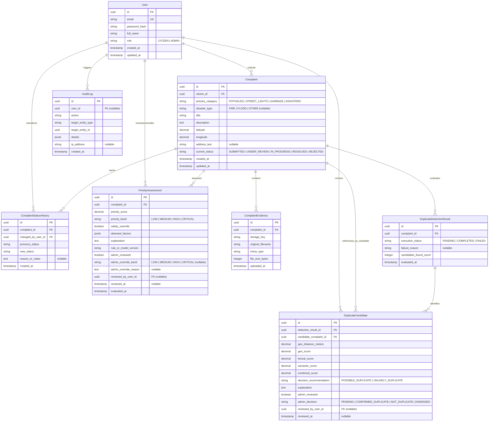
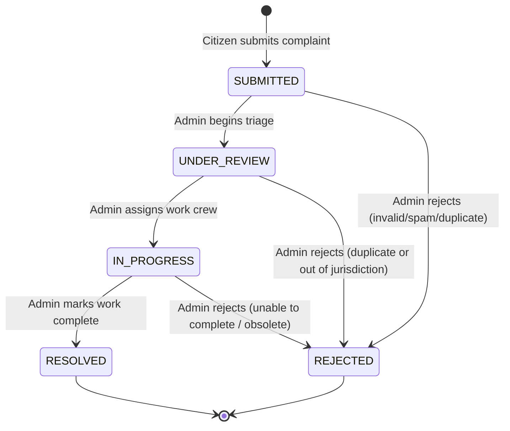

# UrbanPulse — Database Design Specification
**Sprint 0: Requirements, System Architecture and Project Blueprint**
*Document Version: 1.0.0*

---

## 1. Database Overview & Design Principles

UrbanPulse uses **PostgreSQL 16** as its persistent relational data store, managed via the **Prisma ORM** in the Node.js backend. 

### Core Design Principles
1. **Relational Integrity & ACID Compliance:** All status updates, audit records, and history entries execute within atomic database transactions (`$transaction`).
2. **Metadata-Only Binary Storage:** Binary photographic evidence is never stored in database tables (no `BLOB`/`BYTEA` columns for photos). Only sanitized file metadata (file path, MIME type, size, hash) is stored in PostgreSQL. Binary files reside in an abstracted file-storage layer.
3. **Immutability of Audit Trails:** History entries (`ComplaintStatusHistory`) and audit logs (`AuditLog`) are strictly insert-only and cannot be updated or deleted.
4. **Pragmatic Schema Simplicity:** Clear table relationships with targeted B-tree indexes for fast filtering, pagination, and geospatial bounding-box queries, avoiding unnecessary overhead.

---

## 2. Entity-Relationship Model



---

## 3. Entity Specifications

### 3.1 `User`
- **Purpose:** Stores authenticated accounts for both citizens and municipal administrators.
- **Fields:**
  - `id`: `UUID` (Primary Key, default `gen_random_uuid()`).
  - `email`: `VARCHAR(255)` (Required, Unique, lowercase, indexed).
  - `password_hash`: `VARCHAR(255)` (Required, bcrypt hash).
  - `full_name`: `VARCHAR(100)` (Required).
  - `role`: `VARCHAR(20)` (Required, values: `'CITIZEN'`, `'ADMIN'`).
  - `created_at`: `TIMESTAMPTZ` (Default `NOW()`).
  - `updated_at`: `TIMESTAMPTZ` (Auto-updated).
- **Indexes & Constraints:**
  - `UNIQUE(email)`
  - Index on `role` for administrative filtering.

### 3.2 `Complaint`
- **Purpose:** Central entity representing a civic problem reported by a citizen.
- **Fields:**
  - `id`: `UUID` (Primary Key, default `gen_random_uuid()`).
  - `citizen_id`: `UUID` (Foreign Key -> `User.id`, `ON DELETE RESTRICT`, Required).
  - `primary_category`: `VARCHAR(30)` (Required). Strictly one of: `'POTHOLES'`, `'STREET_LIGHTS'`, `'GARBAGE'`, `'DISASTERS'`.
  - `disaster_type`: `VARCHAR(30)` (Optional / Nullable). Populated only if `primary_category == 'DISASTERS'`. Initial values: `'FIRE'`, `'FLOOD'`, `'OTHER'`.
  - `title`: `VARCHAR(150)` (Required, trimmed 5–150 characters).
  - `description`: `TEXT` (Required, 10–2000 characters).
  - `latitude`: `DECIMAL(10, 7)` (Required, $-90.0000000$ to $+90.0000000$).
  - `longitude`: `DECIMAL(10, 7)` (Required, $-180.0000000$ to $+180.0000000$).
  - `address_text`: `VARCHAR(255)` (Optional, human-readable address or landmark).
  - `current_status`: `VARCHAR(25)` (Required, default `'SUBMITTED'`). Values: `'SUBMITTED'`, `'UNDER_REVIEW'`, `'IN_PROGRESS'`, `'RESOLVED'`, `'REJECTED'`.
  - `created_at`: `TIMESTAMPTZ` (Default `NOW()`).
  - `updated_at`: `TIMESTAMPTZ` (Auto-updated).
- **Indexes & Constraints:**
  - Composite Index: `(citizen_id, created_at DESC)` for citizen dashboard queries.
  - Composite Index: `(current_status, primary_category, created_at DESC)` for admin filtering.
  - Spatial Index / B-tree Composite: `(latitude, longitude)` for spatial candidate filtering.

### 3.3 `ComplaintEvidence`
- **Purpose:** Tracks photographic evidence attachments submitted with complaints.
- **Fields:**
  - `id`: `UUID` (Primary Key).
  - `complaint_id`: `UUID` (Foreign Key -> `Complaint.id`, `ON DELETE CASCADE`, Required).
  - `storage_key`: `VARCHAR(255)` (Required, relative path or S3 key, e.g. `evidence/2026/10/uuid.jpg`).
  - `original_filename`: `VARCHAR(255)` (Required, sanitized original client filename).
  - `mime_type`: `VARCHAR(50)` (Required, strictly `'image/jpeg'`, `'image/png'`, or `'image/webp'`).
  - `file_size_bytes`: `INTEGER` (Required, max 5,242,880 bytes / 5MB).
  - `uploaded_at`: `TIMESTAMPTZ` (Default `NOW()`).
- **Indexes:**
  - Index on `complaint_id`.

### 3.4 `ComplaintStatusHistory`
- **Purpose:** Immutable audit record of every status transition a complaint undergoes.
- **Fields:**
  - `id`: `UUID` (Primary Key).
  - `complaint_id`: `UUID` (Foreign Key -> `Complaint.id`, `ON DELETE CASCADE`, Required).
  - `changed_by_user_id`: `UUID` (Foreign Key -> `User.id`, `ON DELETE RESTRICT`, Required).
  - `previous_status`: `VARCHAR(25)` (Required).
  - `new_status`: `VARCHAR(25)` (Required).
  - `reason_or_notes`: `TEXT` (Optional, required when transitioning to `REJECTED`).
  - `created_at`: `TIMESTAMPTZ` (Default `NOW()`).
- **Indexes:**
  - Index on `(complaint_id, created_at ASC)`.

### 3.5 `DuplicateDetectionResult`
- **Purpose:** Records the execution and high-level outcome of an AI duplicate evaluation run for a complaint.
- **Fields:**
  - `id`: `UUID` (Primary Key).
  - `complaint_id`: `UUID` (Foreign Key -> `Complaint.id`, `ON DELETE CASCADE`, Required).
  - `execution_status`: `VARCHAR(20)` (Required, `'PENDING'`, `'COMPLETED'`, `'FAILED'`).
  - `failure_reason`: `TEXT` (Nullable, captures timeout or service error).
  - `candidates_found_count`: `INTEGER` (Default 0).
  - `evaluated_at`: `TIMESTAMPTZ` (Default `NOW()`).
- **Indexes:**
  - Unique / Index on `complaint_id`.

### 3.6 `DuplicateCandidate`
- **Purpose:** Details each historical complaint identified as a potential duplicate match.
- **Fields:**
  - `id`: `UUID` (Primary Key).
  - `detection_result_id`: `UUID` (Foreign Key -> `DuplicateDetectionResult.id`, `ON DELETE CASCADE`, Required).
  - `candidate_complaint_id`: `UUID` (Foreign Key -> `Complaint.id`, `ON DELETE RESTRICT`, Required).
  - `geo_distance_meters`: `DECIMAL(8, 2)` (Required, computed via Haversine).
  - `geo_score`: `DECIMAL(5, 4)` (Required, 0.0000 to 1.0000).
  - `lexical_score`: `DECIMAL(5, 4)` (Required, 0.0000 to 1.0000, TF-IDF cosine).
  - `semantic_score`: `DECIMAL(5, 4)` (Required, 0.0000 to 1.0000, Sentence-Transformers cosine).
  - `combined_score`: `DECIMAL(5, 4)` (Required, 0.0000 to 1.0000, weighted sum).
  - `decision_recommendation`: `VARCHAR(30)` (`'POSSIBLE_DUPLICATE'`, `'UNLIKELY_DUPLICATE'`).
  - `explanation`: `TEXT` (Required, human-readable rationale).
  - `admin_reviewed`: `BOOLEAN` (Default `FALSE`).
  - `admin_decision`: `VARCHAR(30)` (Default `'PENDING'`. Values: `'PENDING'`, `'CONFIRMED_DUPLICATE'`, `'NOT_DUPLICATE'`, `'DISMISSED'`).
  - `reviewed_by_user_id`: `UUID` (Foreign Key -> `User.id`, Nullable).
  - `reviewed_at`: `TIMESTAMPTZ` (Nullable).
- **Indexes:**
  - Index on `(detection_result_id, combined_score DESC)`.
  - Index on `candidate_complaint_id`.

### 3.7 `PriorityAssessment`
- **Purpose:** Stores the AI-evaluated severity, risk factors, and advisory priority level for a complaint.
- **Fields:**
  - `id`: `UUID` (Primary Key).
  - `complaint_id`: `UUID` (Foreign Key -> `Complaint.id`, `ON DELETE CASCADE`, Required).
  - `priority_score`: `DECIMAL(5, 2)` (Required, 0.00 to 100.00).
  - `priority_band`: `VARCHAR(20)` (Required, strictly `'LOW'`, `'MEDIUM'`, `'HIGH'`, `'CRITICAL'`).
  - `safety_override`: `BOOLEAN` (Required, `TRUE` if triggered by emergency rules).
  - `detected_factors`: `JSONB` (Required, structured array of extracted risk factors, keywords, and impacts).
  - `explanation`: `TEXT` (Required, human-readable scoring breakdown).
  - `rule_or_model_version`: `VARCHAR(50)` (Required, e.g., `'rules-v1.0.0'`).
  - `admin_reviewed`: `BOOLEAN` (Default `FALSE`).
  - `admin_override_band`: `VARCHAR(20)` (Nullable, `'LOW'`, `'MEDIUM'`, `'HIGH'`, `'CRITICAL'`).
  - `admin_override_reason`: `TEXT` (Nullable, mandatory if admin overrides).
  - `reviewed_by_user_id`: `UUID` (Foreign Key -> `User.id`, Nullable).
  - `reviewed_at`: `TIMESTAMPTZ` (Nullable).
  - `evaluated_at`: `TIMESTAMPTZ` (Default `NOW()`).
- **Indexes:**
  - Unique / Index on `complaint_id`.
  - Index on `priority_band` for triage queues.

### 3.8 `AuditLog`
- **Purpose:** Centralized, immutable log of administrative actions, status changes, and priority overrides.
- **Fields:**
  - `id`: `UUID` (Primary Key).
  - `user_id`: `UUID` (Foreign Key -> `User.id`, Nullable for system tasks, `ON DELETE SET NULL`).
  - `action`: `VARCHAR(50)` (Required, e.g., `'STATUS_CHANGE'`, `'DUPLICATE_REVIEW'`, `'PRIORITY_OVERRIDE'`).
  - `target_entity_type`: `VARCHAR(50)` (Required, e.g., `'Complaint'`, `'DuplicateCandidate'`).
  - `target_entity_id`: `UUID` (Required).
  - `details`: `JSONB` (Required, captures old/new values, reasons, IP context).
  - `ip_address`: `VARCHAR(45)` (Nullable, client IP).
  - `created_at`: `TIMESTAMPTZ` (Default `NOW()`).
- **Indexes:**
  - Index on `(target_entity_type, target_entity_id)`.
  - Index on `(user_id, created_at DESC)`.

---

## 4. Complaint Status Lifecycle & State Machine



### 4.1 Permitted Transitions & Authorization Matrix

| Initial Status | Target Status | Authorized Roles | Mandatory Requirements |
| :--- | :--- | :--- | :--- |
| *None* | `SUBMITTED` | `CITIZEN` | Initial complaint submission with required fields. |
| `SUBMITTED` | `UNDER_REVIEW` | `ADMIN` | Admin opens complaint and accepts into triage queue. |
| `SUBMITTED` | `REJECTED` | `ADMIN` | Mandatory rejection reason provided in notes. |
| `UNDER_REVIEW` | `IN_PROGRESS` | `ADMIN` | Work dispatched or assigned. Optional dispatch notes. |
| `UNDER_REVIEW` | `REJECTED` | `ADMIN` | Mandatory rejection reason. |
| `IN_PROGRESS` | `RESOLVED` | `ADMIN` | Work completed. Optional resolution notes. |
| `IN_PROGRESS` | `REJECTED` | `ADMIN` | Mandatory rejection reason. |

*Disallowed Transitions:*
- Citizens cannot change complaint status under any circumstance.
- A `RESOLVED` or `REJECTED` complaint cannot transition back to `SUBMITTED`.
- No skipping states directly from `SUBMITTED` to `RESOLVED` without administrative review.

---

## 5. Photographic Evidence Storage Abstraction

To ensure performance, maintainability, and clean separation of concerns, binary photo storage is decoupled from the relational database:

```
[Citizen Client]
       │ Multipart/form-data upload
       ▼
[Express Multer Middleware]
       │ 1. Validate MIME (image/jpeg, image/png, image/webp)
       │ 2. Validate Size (< 5MB)
       │ 3. Strip EXIF & Generate UUID filename
       ▼
[IStorageService Abstraction]
   ├── LocalStorageDriver (Default in Sprint 0-9)
   │     └─ Writes sanitized binary to host-mounted volume `/uploads/evidence/...`
   └── S3StorageDriver (Future production expansion)
         └─ Puts binary to AWS S3 / MinIO / GCP Bucket
       │
       ▼ (Returns storage_key, e.g. "evidence/2026/uuid.webp")
[PostgreSQL Database]
   └── Stores metadata record in `ComplaintEvidence`
```

### Storage Interface Contract
```typescript
interface IStorageService {
  saveFile(fileBuffer: Buffer, originalName: string, mimeType: string): Promise<string>;
  getFileStream(storageKey: string): Promise<ReadableStream>;
  deleteFile(storageKey: string): Promise<void>;
}
```

---

## 6. Forward Schema Evolution Strategy

To ensure future platform growth without breaking historical records:
1. **Extensible Disaster Types:** The `disaster_type` column is designed as a string rather than a rigid SQL enum. New disaster types (e.g. `EARTHQUAKE`, `GAS_LEAK`) can be introduced in backend validation schemas without running destructive database table migrations.
2. **Nullable Audit Fields:** Admin review fields on `DuplicateCandidate` and `PriorityAssessment` are nullable, ensuring backward compatibility with complaints processed prior to review workflows.
3. **Additive Schema Updates:** New feature additions in future sprints must use non-null columns with defaults or optional (nullable) fields to prevent locks and table rebuilds on large datasets.

---

## 7. Implementation Status & Sprint Boundaries

### 7.1 Implemented in Sprint 2 (Active Schema)
The foundational authentication and auditing schema is implemented and generated via Prisma Client 5.22.0:

- **Models:**
  - `User`: Primary user identity and authentication record. Includes role-based constraints (`CITIZEN`, `ADMIN`), unique normalized email, and bcrypt work factor 12 password hash.
  - `AuditLog`: Immutable action log recording administrative state changes with JSONB delta payloads.
- **Enums:**
  - `Role`: `CITIZEN`, `ADMIN`.
- **Migration:**
  - `20261026000000_init_auth` located in `backend/prisma/migrations/`.
- **Database Engine Compatibility:**
  - PostgreSQL 16/17 and Neon Cloud PostgreSQL (Serverless) via standard connection pooling (`DATABASE_URL`).

### 7.2 Implemented in Sprint 3 (Active Schema)
The civic complaint management persistence schema is implemented and generated via Prisma Client 5.22.0:

- **Models:**
  - `Complaint`: Central civic complaint entity containing creator ID, category, optional disaster type, title, description, coordinates (DECIMAL 10,7), and current status with indexes on `(citizen_id, created_at DESC)`, `(current_status, primary_category, created_at DESC)`, and `(latitude, longitude)`.
  - `ComplaintEvidence`: Photo attachment metadata tracking opaque storage key, original filename, MIME type, and file size in bytes with foreign key relation to Complaint (CASCADE).
  - `ComplaintStatusHistory`: Immutable audit history of all status transitions tracking previous status, new status, changed_by user, and mandatory reason notes for rejections (CASCADE).
- **Enums:**
  - `ComplaintCategory`: `POTHOLES`, `STREET_LIGHTS`, `GARBAGE`, `DISASTERS`.
  - `ComplaintStatus`: `SUBMITTED`, `UNDER_REVIEW`, `IN_PROGRESS`, `RESOLVED`, `REJECTED`.
- **Migration:**
  - `20261027000000_add_complaints` located in `backend/prisma/migrations/`.

### 7.3 Planned for Subsequent Sprints
- **Sprint 7 (AI Integration):** `DuplicateDetectionResult`, `DuplicateCandidate`, `PriorityAssessment`.

